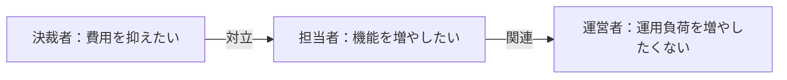
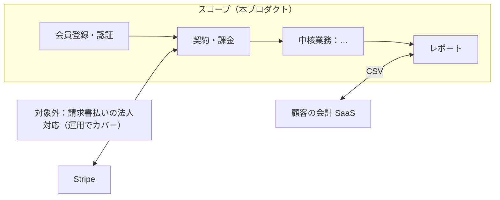
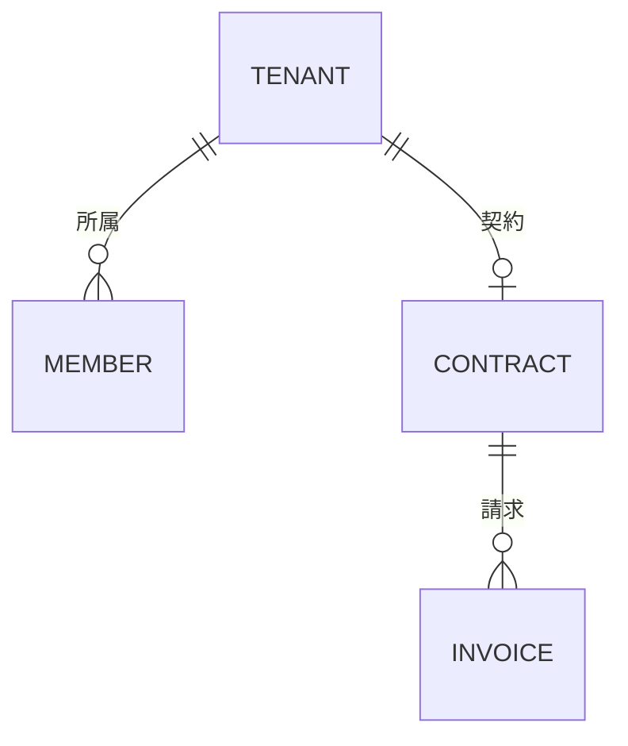
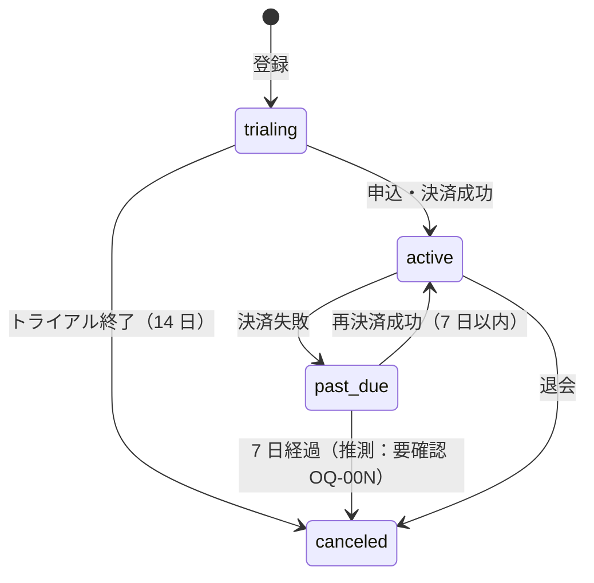

# 要件定義書（docs/03-requirements/requirements.md）

> この文書について：要件定義の**正本**。企画書・戦略書から確定事項を ID 付きで転記し、ステークホルダ・現状・スコープ・業務モデル・外部インターフェース・運用と移行の方針・受入基準・投資と効果をまとめる。業務要件（BZ）・ユースケース（UC）・非機能（NFR）・権限（ROLE）・用語・未決（OQ）は分離文書に置き、本書は要約と参照を持つ。投資判断・開発着手判断（Phase 6 → 7）のベース。想定読者：発注者（自社なら本人）・PM・全下流エージェント。
> 関連文書：企画書（docs/01-concept/concept.md）／戦略書（docs/02-business-strategy/business-strategy.md）／上流突合表（upstream-reconciliation.md）／業務要件一覧（business-requirements.md）／ユースケース一覧（use-cases.md）／非機能要件一覧（non-functional.md）／ロール・権限（permissions-matrix.md）／用語集（glossary.md）／要確認事項（open-questions.md）／決定ログ（decision-log.md）
> 記述規約：`.agents/skills/requirements-toolkit/references/writing-rules.md`。文書の粒度：`document-guide.md`

- **プロダクト名（仮）**：　**案件種別**：自社プロダクト／クライアント案件（concept.md から転記）
- **作成日**：YYYY-MM-DD　**版**：v0.1（draft）　**作成者**：requirements-architect　**最終承認者**：
- **文書セット**：docs/99-pm/document-set.md（プロファイル：full-saas／internal-tool／api-mcp／minimal）

## 0. 文書構成（この案件で作る文書と参照関係）

```
requirements.md（本書）
 ├─ 参照：concept.md（OBJ）／business-strategy.md（SEG・KPI）／upstream-reconciliation.md
 ├─ business-requirements.md（BZ）── use-cases.md（UC）／non-functional.md（NFR）
 ├─ permissions-matrix.md（ROLE）／glossary.md／open-questions.md → decision-log.md
 └─ 下流：10-business-design/feature-list.md（F ← BZ）／business-flow.md／20-external-design/data-model.md／40-test-plan/e2e-scenarios.md（← UC）
除外した文書：（document-set.md の除外行と理由をここに 1 行ずつ）
```

## 1. プロダクト概要

- **一文で**：（提供価値。concept §2.2 から転記）
- **解決する課題**：（concept §1.2 の定量化された課題。詳細は business-requirements.md §1）
- **案件の背景・きっかけ**：（concept §1.1）

## 2. 上流からの確定事項（転記。変更は Phase 1／3 差し戻し）

| 項目 | 内容 | 出所 |
|------|------|------|
| 達成目標 | OBJ-01（…）／OBJ-02（…） | concept §4 |
| ターゲット | SEG-01（…）／SEG-02（…） | strategy §3 |
| 提供価値・ポジショニング | | concept §2.2／strategy §2.3 |
| 成果物スコープ | 営業ポータル：必要／簡易版／不要、モバイル：…、LINE：…、MCP：…、法務文書：… | concept §3／strategy §5.3 |
| 収益モデル・価格仮説 | | strategy §4.1-4.2 |
| チャネル | | strategy §5.1 |
| KPI 目標（北極星含む） | KPI-01（…）／KPI-02（…） | strategy §6 |
| 撤退条件・PMF 判定 | | strategy §7 |
| 法規制の初出し | | strategy §8 |
| 制約と前提（財務・1 名運用） | | concept §7 |

上流との矛盾・欠落：open-questions.md の OQ-NNN（種別：上流矛盾／上流欠落）を参照。

## 3. ステークホルダ

### 3.1 一覧

| ID | ステークホルダ | 区分（直接／間接） | 役割（意思決定／実行／相談／報告） | 影響度 | 関心度 | 関与（ヒアリング／レビュー／承認） | 対応方針・備考 |
|----|---------------|------------------|--------------------------------|--------|--------|--------------------------------|---------------|
| SH-01 | 顧客企業の管理者（ROLE-02） | 直接・最終利用者 | 実行／レビュー | 大 | 大 | ヒアリング・UAT | SEG-01 の代表顧客 A 社 |
| SH-02 | 顧客企業の決裁者 | 直接・評価者 | 意思決定 | 大 | 中 | 承認 | 価格・契約条件に関心 |
| SH-03 | 運営者（野口さん、ROLE-09） | 直接・運用者 | 意思決定／実行 | 大 | 大 | — | 1 名運用の制約を代表 |
| SH-04 | Stripe（外部システム） | 間接 | — | 中 | — | 仕様確認 | Webhook・税処理の制約 |

### 3.2 対立・関連（リッチピクチャ）



合意が難しい課題（対立が多い・提示者が多い）：（列挙し、business-requirements.md §1 の P-No へ）

## 4. 現状（As-Is）

- **業務シナリオ**：（顧客が今この業務をどう済ませているか。1 回の処理を最初から最後まで）
- **既存システム・資料**：（既存ツール・Excel・競合製品・規程・マニュアル。最新性と差異）
- **調査方法**：（操作／インタビュー／観察／シャドーイング／リバースのどれを実施したか）
- 問題・課題の一覧は business-requirements.md §1。「現行踏襲」は要求として受け入れていない（受け入れた箇所があれば理由）

## 5. 要求構造の要約

- 要求構造図と全 BZ は business-requirements.md §2-3。ここでは OBJ ごとに業務目的（BZ）と主要手段を 1 行ずつ要約する

| OBJ | 業務目的（BZ） | 目標（測定尺度・現状 → 目標・期日） | 主要手段（BZ） | 採用件数（Must/Should/Could） |
|-----|---------------|-----------------------------------|---------------|---------------------------|
| OBJ-01 | BZ-001 … | 締め作業 6h → 1h（2027-01） | BZ-003（IT）／BZ-011（業務） | 2/1/0 |

## 6. スコープ

### 6.1 業務スコープ（ビジネスプロセス関連図）

対象業務を 1 枚で鳥瞰し、スコープの境界と外部との情報のやり取りを示す。



### 6.2 MVP（初回リリース）に含める要求

| BZ（IT 手段） | 手段 | MoSCoW | 対応 UC | 備考 |
|--------------|------|--------|---------|------|
| BZ-003 | | Must | UC-BILLING-01 | |

### 6.3 先送り（次期候補）

| BZ | 手段 | 先送り理由 | 再検討時期 |
|----|------|-----------|-----------|

### 6.4 やらないこと（棄却・対象外）

- （concept §5 と business-requirements.md の棄却行を統合。理由付き）

### 6.5 業務パターンの対象

business-requirements.md §4 の業務パターン表のうち、MVP で対象とするパターンと、運用でカバーするパターンを列挙する。

### 6.6 要求量とベースライン

- ベースライン（予算・期限から）：IT 手段 ≦ N 件（または概算 ¥）
- 現在：採用 N 件／先送り N 件／棄却 N 件。超過なし／超過分の扱い

## 7. 業務モデル（To-Be）

### 7.1 概念データモデル（主要エンティティと多重度）



多重度から読める業務ルール：（例：1 テナントに契約は同時に 1 つ。請求は契約が無いと発生しない）。具体値での検証例：（例：契約 1 件 → 月次請求 12 件/年）。詳細は Phase 9 data-model.md。

### 7.2 状態遷移（主要管理対象）



推測した遷移には「推測」と注記し、OQ を付ける。

### 7.3 変革ポイント（As-Is → To-Be）

| # | 変わる業務 | As-Is | To-Be | 観点（廃止／集約／連結／並行化／システム化／人手に戻す） | 関連 BZ |
|---|-----------|-------|-------|------------------------------------------------------|---------|

## 8. ユースケース（要約）

UC 一覧と記述は use-cases.md。ここでは業務領域ごとの UC 数と Critical UC を列挙する。

| 業務領域 | UC 数 | Critical UC（売上直結・データ毀損リスク） |
|---------|-------|------------------------------------------|

## 9. 外部インターフェース一覧

| ID | 名称 | 接続先 | 方向（出力／入力） | 既存／新規 | 方式・形式 | タイミング | 制約（レート制限・料金・障害時） | 下流 |
|----|------|--------|------------------|-----------|-----------|-----------|-------------------------------|------|
| IF-01 | 決済イベント | Stripe | 入力（Webhook） | 新規 | HTTPS・JSON | 随時 | 署名検証・冪等性。停止時は再試行＋日次突合（NFR-OPS-03） | EXT-001 |
| IF-02 | 認証 | Google（IdP） | 入出力 | 新規 | OAuth 2.0 | 随時 | | |
| IF-03 | 売上 CSV | 顧客の会計 SaaS | 出力 | 新規 | CSV | 月次 | 文字コード・項目順を顧客と合意 | |

Phase 7 の external-integrations.md（EXT-NNN）で確定する。

## 10. 非機能要件（要約）

non-functional.md が正本。ここでは Tier A 既定値との差分と、ビジネス領域の要求だけを要約する。

| カテゴリ | 既定値との主な差分 | 理由 |
|---------|------------------|------|
| AVL | | |
| PERF | 想定規模：MAU … ／ピーク … ／1 年後 … | strategy SOM |
| OPS | | |
| MIG | | |
| SEC | | |
| ENV | 月額上限 ¥… | concept §7 |

## 11. ロール・権限（要約）

permissions-matrix.md が正本。ロール一覧（ROLE-NN）と、権限に関する業務ルール（最終管理者の退会禁止等）を転記する。

## 12. 制約条件

| 項目 | 内容 | 出所 |
|------|------|------|
| 開発時間（週あたり） | | |
| 開発予算／運用予算（月あたり上限） | | concept §7 |
| ローンチ目標時期と根拠 | | strategy §5.4 |
| 必須／禁止の技術・ベンダー | | |
| 法的整備（利用規約・特商法・プライバシーポリシー・インボイス） | 担当・時期 | strategy §8 |
| 財務制約 | 一括払いのみ・借入不可・前払い広告 | concept §7 |
| 社内承認プロセス（クライアント案件） | | |

## 13. 運用・移行・公開の方針

- **運用**：サービス時間・計画停止・1 名運用体制・サポート窓口と応答目標・月次／年次の運用スケジュール（NFR-OPS）
- **移行・データ取込**：既存データの有無・件数・クレンジング責任・リハーサル（NFR-MIG-01）
- **公開方式**：スモールスタート（招待制 → 一般公開）か一斉か。フィーチャーフラグ。並行利用と切り戻し条件（NFR-MIG-02/03）
- **教育・オンボーディング**：初回利用の案内。研修データに個人情報を使わない
- 詳細は Phase 11 data-migration.md、Phase 19 runbook.md

## 14. 受入基準とテスト観点

### 14.1 完成の判定

- （「完成した」と判断する具体的条件。UAT の合格ライン。クライアント案件は検収条件）
- 完了判断基準の例：Critical UC の E2E 全件成功、Critical/Major 不具合 0 件、NFR-PERF-01/02 を k6 で満たす

### 14.2 受入テスト観点（Phase 13 test-planner・Phase 16 E2E の入力）

| 観点 | 確認するシナリオ（UC） |
|------|----------------------|
| 通常処理 | |
| 異常処理（エラー・外部障害） | |
| 例外処理（業務上の例外） | |
| 特殊処理（キャンペーン・返金・アカウント統合） | |
| サイクル：日次 | |
| サイクル：月次（請求確定・プラン変更の月跨ぎ） | |
| サイクル：年次（年額更新・料金改定） | |

### 14.3 パイロット運用

- 期間・対象（招待顧客 N 社）・評価方法・一般公開の判断基準

## 15. 成功指標と撤退条件（転記）

| 時点 | 指標（KPI-NN／OBJ） | 目標値 | 測定方法 |
|------|--------------------|--------|---------|
| ローンチ後 3 ヶ月 | | | |
| ローンチ後 6 ヶ月 | | | |
| 撤退ライン | strategy §7 | | |

撤退時のユーザー・データ対応：（データエクスポート・返金・告知期間。NFR-MIG-04 と利用規約）

## 16. リスク（初出し → docs/99-pm/risk-register.md）

| RSK | リスク（プロジェクト／プロダクト） | 影響 | 確率 | 対策・監視 |
|-----|----------------------------------|------|------|-----------|
| | 決まらない要件 OQ-00N が期限内に決まらない | | | |
| | Stripe の仕様変更 | | | |

## 17. 投資と効果の概算（完了判断の材料）

| 区分 | 内容 | 金額・値 |
|------|------|---------|
| 投資：初期開発 | 自分の稼働 … 時間 ＋ 外注 ¥… | |
| 投資：運用（36 ヶ月） | 月額ランニング ¥… × 36 ＋ 運用稼働 | |
| 投資：コンティンジェンシー | 20〜30% | |
| 効果：定量（3 年累積） | MRR・コスト削減（strategy §4.3 と整合） | |
| 効果：定性 | 5 段階評価（受益者の評価と達成コミットメント） | |
| 判断 | 着手／縮小／棚上げ／中止 のどれを推奨するか、その理由 | |

## 18. 未決事項

open-questions.md が正本。完了時点で open の OQ の件数と、先送り基準を満たしている旨をここに 1 行書く。

## 19. Before / After（決裁者向け 1 枚）

| 項目 | 内容 |
|------|------|
| 狙い | （OBJ） |
| 現状と問題点 | （定量） |
| 改革後の姿 | （図・3 つの主要ポイント） |
| 予測効果（定量／定性） | （KPI 目標） |
| 前提条件・要検討事項 | |

## 20. 別添

- business-requirements.md／use-cases.md／non-functional.md／permissions-matrix.md／glossary.md／open-questions.md／decision-log.md／upstream-reconciliation.md
- 競合調査メモ（strategy §2）、技術検証結果（PoC がある場合）

## ✅ Self-Check（提出前セルフレビュー）

- [ ] §2 の転記が concept／strategy の原文と一致し、出所がある。独自に書き換えていない
- [ ] §3 に直接・間接のステークホルダと意思決定者がある
- [ ] §4 で「現行踏襲」を受け入れていない
- [ ] §5-6 の採用 BZ が business-requirements.md の採否列と一致し、要求量がベースラインに収まっている
- [ ] §7 の概念データモデル・状態遷移があり、推測遷移に OQ がある
- [ ] §9 外部 I/F に方向・既存/新規・方式・タイミング・障害時方針がある
- [ ] §13 運用・移行・公開方針が決まっている
- [ ] §14 に 4 観点＋3 サイクルの受入テスト観点がある
- [ ] §17 投資と効果の概算があり、縮小・中止の選択肢を検討した
- [ ] §18 の open OQ が先送り基準を満たしている
- [ ] completeness-checklist.md の全項目が ✅ または N/A
- [ ] writing-rules §7 の推敲を実施した（禁止語 0 件、1 文 200 文字以内、接続助詞「が」なし）

## 📤 Handoff

- **次フェーズ**：Phase 6 requirements-reviewer
- **上流差し戻し候補**：Phase 1（企画）へ：…／Phase 3（戦略）へ：…／なし
- **決まらない要件**：OQ-… （件数・先送り基準の充足）
- **要求量**：採用 N／先送り N／棄却 N（ベースライン …）
- **完了判断の材料**：§17 の推奨（着手／縮小／棚上げ／中止）
- **下流への引き継ぎ**：business-flow-designer（BZ の IT 手段 → F、UC 追記）、tech-stack-architect（NFR）、test-planner（§14、UC）、cost-guardian（NFR-PERF-04・ENV-04）
