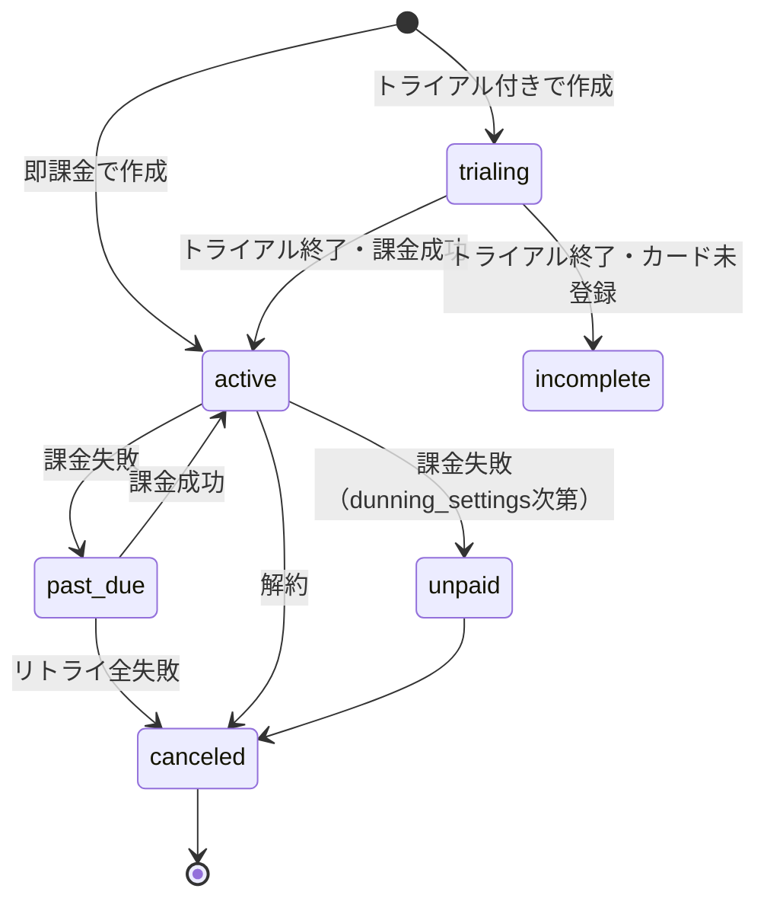

# Stripe Subscription Design

SaaS の月額定額モデルを Stripe で組み立てるための設計指針。

## プラン構造の基本

### Product と Price の関係

```
Product: 「SaaS製品X」
├── Price: 月額 ¥1,980（recurring, interval: month）
├── Price: 年額 ¥19,800（recurring, interval: year, 約2ヶ月分OFF）
├── Price: スタータープラン 月額 ¥980
└── Price: プロプラン 月額 ¥3,980
```

- **Product**：販売単位（≒プランファミリー）
- **Price**：具体的な価格（月額/年額、通貨、課金頻度）

複数プラン（Starter/Pro/Enterprise）は **1 Product に複数 Price** にするか、**プランごとに別 Product** にするかは選択。

**推奨**：プランごとに別 Product。各プランの特典・名前を Stripe Dashboard 側で管理しやすい。

### 価格設定の判断軸

| 軸 | 推奨 |
|----|------|
| 通貨 | JPY（日本国内向け）、必要に応じて USD |
| 課金単位 | 月額（基本）、年額（割引付き） |
| 税の扱い | 内税（消費者向けSaaS）or 外税（B2B） |
| トライアル | 14日無料（推奨）または 無し |
| 従量課金 | metered price（API使用量等で必要時） |

## サブスクリプション状態遷移



### 各状態の意味と対応

| 状態 | 意味 | 自社アプリでの扱い |
|------|------|----------------|
| `trialing` | トライアル中 | フル機能アクセス可 |
| `active` | 課金中 | フル機能アクセス可 |
| `past_due` | 課金失敗（リトライ中） | アクセス継続（猶予期間）or 制限 |
| `unpaid` | リトライ全失敗 | 機能制限 |
| `canceled` | 解約済み | アクセス制限・データ保持期間に従う |
| `incomplete` | 初回課金未完了 | アクセス不可 |
| `incomplete_expired` | 初回課金期限切れ | アクセス不可 |

## トライアル設計

### Stripe側の設定
```typescript
const session = await stripe.checkout.sessions.create({
  mode: 'subscription',
  subscription_data: {
    trial_period_days: 14,
    trial_settings: {
      end_behavior: {
        missing_payment_method: 'cancel',  // カード未登録なら自動解約
      },
    },
  },
  payment_method_collection: 'if_required',  // トライアル時は任意
  // ...
});
```

### トライアル選択肢

| パターン | カード登録 | リスク | コンバージョン |
|---------|----------|-------|--------------|
| **オプトイン**（推奨） | 不要 | 低 | 中 |
| **強制カード登録** | 必須 | 中 | 高（解約忘れ多い） |
| **クレジット先払い** | 必須・先課金 | 高 | 低 |

野口さんのB2B SaaSなら**オプトイン**を推奨。クライアント側の社内承認フローを邪魔しない。

## アップグレード / ダウングレード

### 即時切り替え（推奨）

```typescript
await stripe.subscriptions.update(subscriptionId, {
  items: [{
    id: itemId,
    price: newPriceId,
  }],
  proration_behavior: 'create_prorations',  // 日割り計算
});
```

`proration_behavior` の選択：
- `create_prorations`：日割りで差額を即時請求/クレジット（推奨）
- `none`：次回請求から新料金（シンプルだが理不尽な印象）
- `always_invoice`：別請求書として即送付

## 解約フロー

### Customer Portal を使う場合（推奨）

```typescript
const portalSession = await stripe.billingPortal.sessions.create({
  customer: customerId,
  return_url: `${appUrl}/billing`,
});

return Response.json({ url: portalSession.url });
```

Customer Portal の機能：
- カード変更
- 請求履歴ダウンロード
- 解約（即時 or 次回更新時）
- プラン変更（許可した範囲で）

### 解約タイミングの選択

| 方式 | 設定 | 採用シーン |
|------|------|----------|
| 期間終了時 | `cancel_at_period_end: true` | **推奨**（顧客満足度高い） |
| 即時 | `cancel_at` または `cancel_now()` | 重大規約違反等 |

### 解約後のデータ保持

要件定義で以下を確定：
- 解約後 N日間はログイン可能（読み取りのみ）
- N日後にアカウント削除 or 凍結
- データエクスポート機能の提供有無
- 個人情報の削除タイミング（GDPR/個情法対応）

## 失敗時の Dunning（督促）

Stripe Dashboard で設定：
- リトライ間隔（例：1日後、3日後、7日後）
- 顧客への通知メール
- 最終的な扱い（Cancel / Mark uncollectible）

野口さんSaaS向けの推奨設定：
- **リトライ：3回（1日、3日、7日）**
- **顧客通知メール：有効**（Stripe テンプレートを日本語にカスタマイズ）
- **最終扱い：subscription を canceled に**

## 複数テナント・複数組織での扱い

B2B SaaSで「1企業＝複数ユーザー」の場合：

### モデル選択

| パターン | 説明 | 採用シーン |
|---------|------|----------|
| Customer = 企業 | 企業ごとに1 Customer、ユーザーは別 | **推奨**（請求の単位＝企業） |
| Customer = ユーザー | ユーザーごとに Customer | コンシューマー SaaS |

### Customer = 企業の場合の実装

```typescript
// 企業作成時にStripe Customerも作成
const customer = await stripe.customers.create({
  name: orgName,
  metadata: {
    organization_id: orgId,
  },
  tax_id_data: [
    { type: 'jp_trn', value: orgTaxId },  // B2B顧客の登録番号
  ],
});
```

## 自社DB側のスキーマ例

```sql
CREATE TABLE customers (
  id UUID PRIMARY KEY,
  organization_id UUID NOT NULL REFERENCES organizations(id),
  stripe_customer_id TEXT UNIQUE NOT NULL,
  email TEXT NOT NULL,
  created_at TIMESTAMPTZ DEFAULT NOW(),
  updated_at TIMESTAMPTZ DEFAULT NOW()
);

CREATE TABLE subscriptions (
  id UUID PRIMARY KEY,
  customer_id UUID NOT NULL REFERENCES customers(id),
  stripe_subscription_id TEXT UNIQUE NOT NULL,
  stripe_price_id TEXT NOT NULL,
  status TEXT NOT NULL,  -- active, trialing, past_due, canceled, etc.
  current_period_start TIMESTAMPTZ NOT NULL,
  current_period_end TIMESTAMPTZ NOT NULL,
  cancel_at_period_end BOOLEAN DEFAULT FALSE,
  canceled_at TIMESTAMPTZ,
  trial_end TIMESTAMPTZ,
  metadata JSONB,
  created_at TIMESTAMPTZ DEFAULT NOW(),
  updated_at TIMESTAMPTZ DEFAULT NOW()
);

CREATE INDEX idx_subscriptions_status ON subscriptions(status);
CREATE INDEX idx_subscriptions_customer ON subscriptions(customer_id);
```

## チェックリスト

設計完了時のセルフチェック：

- [ ] Product/Price の構造を定義
- [ ] トライアル期間と end_behavior
- [ ] アップグレード/ダウングレードの proration ポリシー
- [ ] 解約タイミングの方針
- [ ] 解約後のデータ保持期間
- [ ] Dunning（督促）設定
- [ ] Customer = 企業 / ユーザー の選択
- [ ] 自社DBスキーマと Stripe Object の対応
- [ ] B2B顧客の税ID登録フロー
- [ ] 適格請求書発行事業者の登録番号設定（自社側）

## アンチパターン

- 自社DBで Subscription 状態を主導（→ Stripe が Source of Truth）
- トライアルでカード強制（→ 業務SaaSではB2B承認フローと相性悪い）
- 解約フローを自前で実装（→ Customer Portal を使う）
- proration を `none` にする（→ 顧客の不満につながる）
- 失敗時の Dunning を無効化（→ 機会損失）
